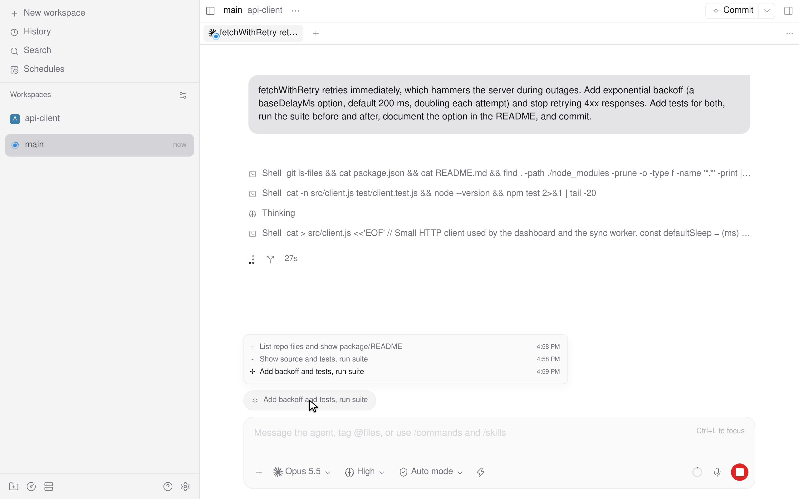
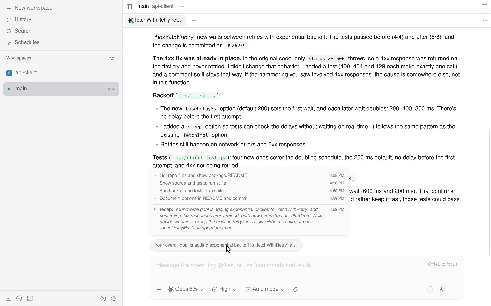

# claude-progress

A [Paseo](https://github.com/getpaseo/paseo) plugin that shows Claude Code's progress above the composer: a short description of each step while Claude works, and a recap of the turn when it stops.

<picture>
  <source media="(prefers-color-scheme: dark)" srcset="images/dark-working.png">
  
</picture>

<picture>
  <source media="(prefers-color-scheme: dark)" srcset="images/dark-recap.png">
  
</picture>

Demo (a real Opus 5.5 run, sped up): https://raw.githubusercontent.com/Rock-Z/paseo-claude-progress/main/images/demo.mp4

## What it shows

The Claude Code CLI shows a short description of each step Claude takes and a recap when Claude stops. Paseo shows neither. This plugin adds a pill above the composer of Claude agents:

- **While Claude works:** the description of its latest `Bash`, `Monitor` or `Agent` call, with Claude Code's Unicode-character spinner.
- **When a turn ends:** a recap of the turn in under 40 words. Claude Haiku writes it from a short summary of the turn, using Claude Code's own recap prompt (see [How it works](#how-it-works)).
- **On click:** the steps of the current turn, with times. Arrows at the bottom right flip through the session's earlier turns and their recaps. On web, the list keeps its scroll position and jumps to new steps.

## Install

Tell your agent:

```text
Install the Paseo plugin from https://github.com/Rock-Z/paseo-claude-progress and confirm it loaded.
```

Or run:

```sh
paseo plugin install git:Rock-Z/paseo-claude-progress
```

## How it works

- **Steps:** Paseo's timeline drops the `description` that Claude writes for each tool call. The daemon side of the plugin reads these descriptions from Claude Code's session log in `$CLAUDE_CONFIG_DIR/projects` (default `~/.claude/projects`).
- **Recaps:** when a turn ends, the plugin runs one `claude -p` call with the `haiku` model alias (the newest Claude Haiku), with no settings, tools or MCP servers. Recaps run one at a time and are saved in `$XDG_CACHE_HOME/claude-progress/recaps` (default `~/.cache/claude-progress/recaps`), so they survive daemon restarts.

Each recap is one Haiku request through your Claude Code login. It sends the session's first request, the latest request, the turn's step descriptions and Claude's final message. The requests and the final message are each cut to 4,000 characters. Nothing else leaves the machine.

## Limitations

- The pill appears only on Claude Code agents, and recaps need the `claude` CLI on the daemon's `PATH`.
- Each recap is one Claude Haiku request through your Claude Code login.
- A step shows only when Claude writes a description for the tool call, and how often it does depends on the model and effort. In our logs, Opus 5.5 described about four in five `Bash` calls and Sonnet 5.5 almost none.

## Development

```sh
npm ci
npm run typecheck
paseo plugin reload claude-progress   # after edits
```

## License

[MIT](LICENSE)
